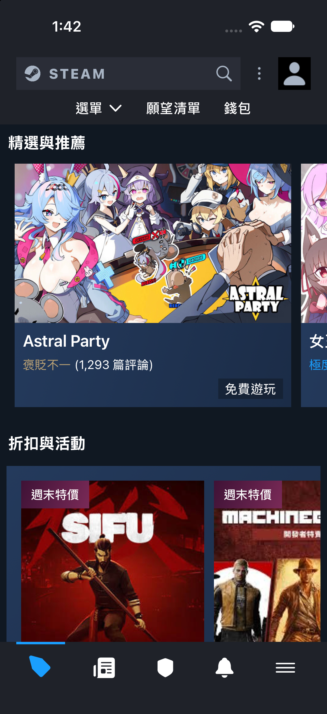

  <h1>🎮 SteamShop </h1>
  

    
    
    
  

  
<b>一個完全使用 SwiftUI 製作模仿的精美 APP 靜態畫面專案 🌈</b>

  
👉 <a href="https://medium.com/@peterabc219/7b10363a477c">查看 Medium 報告</a>

---

## 📸 作品展示 (Picture)

  

## 📚 作業說明 (Assignment Details)

此為 **iOS App 程式設計課程作業** —— **「模仿 App Store 上架的 APP」**。 
專案主要目標是透過實作來熟悉 SwiftUI ，包含：
- 排版功能：Scrollview、VStack、HStack、ZStack...
- 文字圖片：Text、Image、asset、SF Symbol...
- modifier：padding、background、font、foregroundStyle、frame、offset...
- 學習使用多個檔案定義 view 的型別並利用 property 客製自訂的 SwiftUI view

📖 **Medium 文章連結：** 👉 [[點此閱讀完整心得報告]](https://medium.com/@peterabc219/7b10363a477c)
